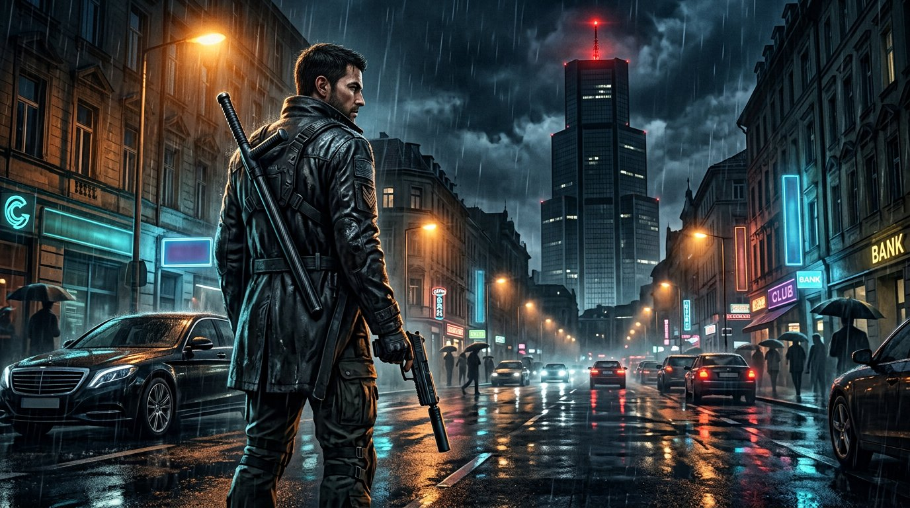

# NEXUS — Version 1.0 Complète



> **Action-Aventure & Tir Tactique en Monde Ouvert Néo-Noir** — Fusionnant le tir nerveux en vue subjective (*Call of Duty*), le combat rapproché viscéral en caméra épaule (*God of War*) et l'exploration urbaine libre (*GTA*) à travers la métropole pluvieuse de **Port-Valois**.

---

## Contenu du Livrable Final

Ce dépôt contient l'intégralité du projet **NEXUS v1.0** conforme au **[Cahier des charges](./cahier_des_charges.md)** (Sections 1 à 15 + Annexe A complète) sous **deux formats complémentaires** :

1. **Édition Web 3D Temps Réel Interactive (`web/`)** — Jouable immédiatement dans le navigateur à **60 FPS** (Three.js + WebGL 2 + Post-Processing Bloom + Synthèse WebAudio adaptative).
2. **Projet Moteur Natif Godot 4.x (`project.godot`, `scenes/`, `scripts/`, `resources/`, `audio/`)** — Architecture GDScript 2.0 typée statiquement, ressources `.tres` pilotées par données, 6 singletons Autoload, scènes modulaires et suite de validation automatisée.
3. **Documentation Narrative & Design Complète (`docs/`)** — Tous les livrables de l'**Annexe A** rédigés en détail :
   - [Annexe A.1 — Synopsis détaillé en 4 Actes, Personnages & Dialogues FR/EN](./docs/annexe_a1_synopsis_et_personnages.md)
   - [Annexe A.2 — Scénario mission par mission (Missions 1 à 15), Contrats, Défis & Rumeurs](./docs/annexe_a2_scenario_missions.md)
   - [Annexe A.3 — Catalogue complet et équilibrage : 4 Armes, Ennemis, Boss, Armures & Arbres de Compétences](./docs/annexe_a3_catalogue_armes_ennemis_objets.md)
   - [Annexe A.4 — Charte Graphique Néo-Noir, Interface Utilisateur & Checklist J1–J6](./docs/annexe_a4_charte_graphique_et_ui.md)

---

## Démarrage Rapide (Quick Start)

### Option A — Jouer dans le navigateur (Web 3D · 60 FPS)
```bash
cd web
npm install
npm run dev
```
Ouvrez l'aperçu en direct sur `http://localhost:5173`.
- Choisissez **« JOUER LA CAMPAGNE »** pour vivre la progression scénarisée dès l'Acte I (Mission 1 à 15).
- Ou cliquez sur **« ACCÈS INTÉGRAL (3 ZONES · 4 ARMES · 15 MISSIONS) »** pour débloquer instantanément les 3 zones, tout l'arsenal, les améliorations et lancer n'importe quelle mission ou contrat depuis le menu `[J]`.

### Option B — Ouvrir dans Godot Engine 4.x (PC Windows / Linux / macOS)
1. Lancez **Godot Engine 4.3+** (Standard GDScript).
2. Cliquez sur **Importer** et sélectionnez le fichier `project.godot` à la racine du dépôt.
3. Appuyez sur **`F5`** pour lancer `res://scenes/main/Main.tscn`.
4. Pour exécuter la suite de tests automatisés en ligne de commande :
   ```bash
   godot4 --headless -s res://tests/run_validation_suite.gd
   ```

---

## Commandes par défaut (Compatibles Clavier **AZERTY `ZQSD`**, **QWERTY `WASD`** & **Manette**)

| Action | Clavier / Souris | Manette |
|---|---|---|
| Déplacements | `Z Q S D` / `W A S D` | Stick Gauche |
| Caméra / Visée | Souris (Clic dans la vue 3D, Glisser ou Flèches) | Stick Droit |
| Courir / Sprint | `Shift` | `L3` |
| Sauter / Escalader un obstacle | `Espace` | `A` / Croix |
| Action principale (Attaque légère / Tir) | `Clic Gauche` | `RT` / `R2` |
| Action secondaire (Visée ADS / Attaque lourde) | `Clic Droit` ou `F` | `LT` / `L2` |
| Parade parfaite (fenêtre timing) | `Q` | `LB` / `L1` |
| Esquive directionnelle (*i-frames*) | `C` ou `Alt` | `B` / Rond |
| Verrouillage cible (Mode Combat) | `Tab` | `R3` |
| Recharger l'arme (Mode Tir FPS) | `R` | `X` / Carré |
| Changer d'arme (Pistolet / Fusil / Pompe / Sniper) | `1` · `2` · `3` · `4` | Pavé directionnel |
| Interagir / Conduire la Berline / Sauvegarder | `E` | `X` / Carré |
| Demander un indice progressif de puzzle | `H` | Menu Carte |
| Campagne `J` · Atelier `I` · Compétences `K` · Carte `M` | `J` / `I` / `K` / `M` / `Échap` | `Start` |
| Bascule de mode libre (Test Sandbox) | `F1` Explo · `F2` Combat · `F3` Tir FPS | Boutons HUD |

---

## Architecture du Dépôt

```text
game_idea/
├── cahier_des_charges.md          # Cahier des charges de référence v1.0
├── project.godot                  # Configuration principale Godot 4.x (Autoloads & InputMap)
├── docs/                          # Annexe A complète (Synopsis, 15 Missions, Armes/IA, Charte UI)
├── interface/artwork/             # Key Art officiel 16:9 & portraits haute définition (Marcus, Elena, Vaneck)
├── audio/                         # Layout des 3 bus audio séparés (Music, SFX, Voice)
├── resources/                     # Ressources .tres (4 armes, ennemis, armures) & JSON des 15 missions
├── scenes/                        # Scènes Godot (.tscn) par entité, puzzle, zone (1 à 3) et interface
├── scripts/                       # Scripts GDScript 2.0 modulaires (autoload, entities, puzzles, world, ui)
├── tests/                         # Suites de validation Godot 4 & vérificateur AST gdparse
└── web/                           # Édition Web 3D jouable complète (Three.js + WebAudio + HUD Néo-Noir)
```

---

## Crédits des modèles 3D / 3D model credits

Les personnages et la voiture utilisent des modèles glTF/GLB chargés depuis `web/public/models/` (décodage Draco dans `web/public/draco/`).

| Fichier | Usage dans le jeu | Source | Licence |
|---|---|---|---|
| `Xbot.glb` | Marcus Vance (joueur), civils | Three.js examples (`examples/models/gltf/`), rig Mixamo | Mixamo / à vérifier avant usage commercial |
| `Soldier.glb` | Exécuteurs Éclipse, Gardes, Tireurs | Three.js examples, rig Mixamo | Mixamo / à vérifier avant usage commercial |
| `ferrari.glb` | Berline (carrosserie de substitution) | Three.js examples | Licence de l'auteur d'origine à vérifier avant usage commercial |

Ces ressources proviennent du dépôt Three.js r170 (licence MIT pour le code ; les licences des assets individuels doivent être vérifiées avant toute distribution commerciale).

The characters and the car are glTF/GLB assets from Three.js r170 examples (Mixamo-rigged humanoids and a sports-car body, with Draco decoding). Individual asset licences must be verified before commercial distribution.
